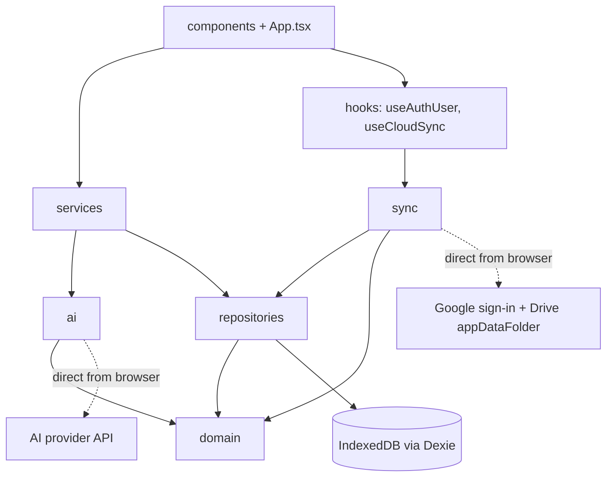
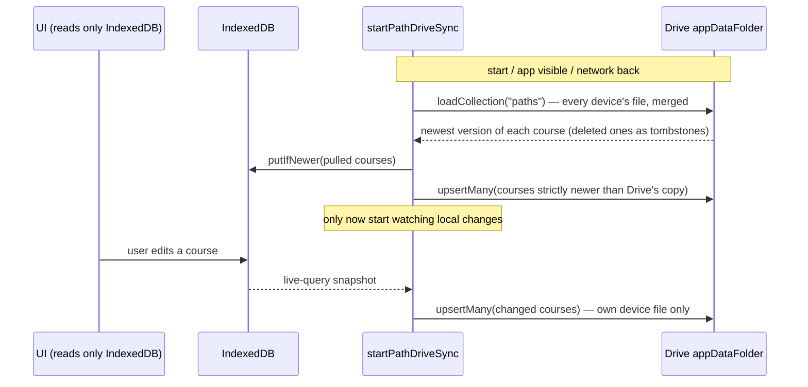

# StepByLearn — High-Level Design

## Requirements

- **Functional:**
  - Generate a structured, multi-step learning path for any topic via a user-chosen LLM
    provider (Anthropic, OpenAI, Groq, or Gemini) — `src/services/generation.ts`.
  - Build a path manually without AI — `src/services/manualBuilder.ts`,
    `src/components/screens/ManualBuilderView.tsx`.
  - Track per-step progress and schedule steps onto a calendar —
    `src/services/progress.ts`, `src/services/calendar.ts`.
  - Work fully offline after generation; optionally sync to the user's own Google Drive for
    multi-device access — `src/sync/pathDriveSync.ts`.
  - Delete a course with Undo (soft delete) — `src/repositories/pathRepository.ts`
    (`deletePath` / `restorePath`).
- **Non-functional:**
  - **Privacy-first**: no StepByLearn server exists. The only outbound calls are the user's
    own browser talking directly to their chosen AI provider and, if they connect it, to
    Google (sign-in and the Drive API). Course data in Drive lives in the hidden
    `appDataFolder`, which only this OAuth client can read (`src/sync/driveSync.ts`'s module
    docstring).
  - **Offline-capable by construction**: the UI reads only from IndexedDB via Dexie's live
    queries (`useLiveQuery` in `src/App.tsx`), never directly from the network.
  - **Provider-swappable**: AI calls go through the `AIStrategy` interface
    (`src/ai/strategy.ts`) backed by the shared `modeldispatcher-browser-agent` package.

## Static view

Dependencies point downward only: e.g. `src/services/generation.ts` imports from `src/ai/*`,
`src/repositories/*` and `src/domain/*`, never the reverse. `src/sync` depends on the
repositories and domain; nothing below the UI depends on `src/sync`.

- **`src/domain`** — framework-free types and rules: `types.ts` (the one shape every layer
  agrees on), `ids.ts`, `dates.ts` (local-calendar-day helpers), `urls.ts` (`toSafeUrl`, only
  http(s) links are ever rendered), and `storedPath.ts` (`parseStoredPath`, which validates
  and backfills any path read from storage we don't fully control).
- **`src/db` + `src/repositories`** — `db/database.ts` defines the Dexie schema (`paths`, plus
  a legacy `settings` table read once by `settingsRepository.migrateLegacySettings`).
  `repositories/pathRepository.ts` is the only module that reads and writes paths; its
  `updatePath` does every read-modify-write inside one transaction.
  `repositories/settingsRepository.ts` re-exports the AI provider config of
  `modeldispatcher-browser-agent`.
- **`src/ai`** — `resolver.ts` builds an `AIStrategy` from the configured provider list;
  `prompts.ts` builds the LLM prompts; `jsonHealer.ts` repairs fragile model output into
  validated domain shapes.
- **`src/sync`** — optional Google Drive sync:
  - `driveDocument.ts` — pure rules: the device-file format, merge (newest entry wins,
    deletes are tombstones), the write-stamp clock guard, and which idle files can be removed.
  - `driveSync.ts` — the Drive client (`createDriveSync`): Google sign-in, token handling,
    retries, one file per device, listing and reading, "delete all synced data".
  - `pathDriveSync.ts` — the engine that mirrors the local `paths` store with Drive
    (`startPathDriveSync`), using `syncPlan.ts` for the per-course conflict rule and
    `pathStore.ts` for local storage access.
  - `drive.ts` / `clientId.ts` — the app's single configured client, from `VITE_GOOGLE_CLIENT_ID`.
  - `dataOwner.ts` — which Google account the courses on this device belong to.
- **`src/services`** — use-cases: `generation.ts`, `manualBuilder.ts`, `calendar.ts`,
  `progress.ts`.
- **`src/hooks`** — `useAuthUser` (who is connected), `useCloudSync` (runs the engine, handles
  the other-account prompt, sign-out and "delete my synced data"), `useBackClose`.
- **`src/components`** — React UI. `App.tsx` is the shell; `components/screens/*` are the five
  views (all but the planner are lazy-loaded); `components/layout/*` is the sidebar and top
  bar; `components/ui/*` holds the shared accessible `Modal`, `ConfirmDialog`, toasts and
  `ErrorBoundary`.
- **`android/` + `capacitor.config.json`** — the Android app: a Capacitor shell around the same
  web build (`webDir: dist`), built and signed by `.github/workflows/android.yml`. It differs
  from the web app in three places only: Google sign-in goes through the OS
  (`src/sync/nativeGoogleAuth.ts`, chosen in `src/sync/drive.ts` when
  `Capacitor.isNativePlatform()`), no service worker is registered (`src/main.tsx`), and
  Android's device backup is disabled in `AndroidManifest.xml`.
- **`legacy-python/`** — an earlier FastAPI + SQLite implementation of the same concept, kept
  for reference per `README.md`; not part of the running app.

Full annotated file list: [`STRUCTURE.md`](STRUCTURE.md).

## Dynamic view

**Primary flow — AI-generated path** (`src/services/generation.ts`):

1. UI calls `generatePath` (or the additional-steps / fix-step variants) with the topic and
   options (step duration, content type, learner background).
2. `resolveStrategy` (`src/ai/resolver.ts`) turns the configured provider list into an
   `AIStrategy`, and throws `MissingApiKeyError` (`src/ai/strategy.ts`) if none is usable.
3. A prompt is built (`src/ai/prompts.ts`) and sent through the strategy, which calls
   `modeldispatcher-browser-agent`'s `complete()` directly from the browser.
4. The raw reply is repaired and validated by `healAndValidate` / `healAndValidateSteps`
   (`src/ai/jsonHealer.ts`) into domain objects; only http(s) links survive.
5. The result is persisted by `pathRepository.savePath` / `appendSteps`.
6. `useLiveQuery` (Dexie) re-renders the UI once the write lands.

**Secondary flow — Drive sync** (`src/sync/pathDriveSync.ts`):

Rules that keep it safe, each in the named file:

- **A stale device can't overwrite newer data.** Nothing is pushed until the first pull has
  succeeded; after that a course is pushed only if its `updatedAt` is strictly newer than what
  was last synced for it (`pathDriveSync.ts`), and the per-course comparison itself is
  `planSync` in `syncPlan.ts`.
- **Pulls can't clobber an edit made while they run.** They write through
  `dexiePathStore.putIfNewer` (`pathStore.ts`), one transaction that skips anything not newer
  than the stored copy.
- **No echo loop.** A pulled course's `updatedAt` is recorded in `lastSynced` before it is
  written, and the local watcher ignores any snapshot not strictly newer than that.
- **Each device writes only its own file** (`stepbylearn-<deviceId>.json`), because Drive v3
  has no conditional write. Readers take the newest entry per course across all files
  (`driveDocument.ts`: `mergeDeviceDocuments`), stamped with a clock that never runs behind
  anything already read (`nextStamp`).
- **Deletes stay deleted.** A deleted course is soft-deleted locally (`deletedAt`) and synced
  as a slim tombstone with no title or steps, so its content leaves Drive; the full copy stays
  on the deleting device so Undo works. A tombstone for a course a device never had isn't
  inserted.
- **Pulls are polled**, not pushed: at start, when the page becomes visible, and when the
  network returns, at most once per 10 seconds (Drive has no change feed).

**Account handling** (`src/hooks/useCloudSync.ts`): the account that owns the courses on a
device is recorded in `localStorage` (`sync/dataOwner.ts`). Signing out removes the courses
from the device and clears that marker, so the next person on a shared browser sees nothing. If
a different account connects on a device that still holds someone else's courses, the app asks
first and then removes them; they are never merged into the new account.

## Data storage

- **Primary store**: browser IndexedDB via Dexie (`src/db/database.ts`). `paths` holds each
  course as one document with its steps embedded; `settings` is a legacy singleton read once
  for migration. Deleted courses stay as tombstones for 90 days
  (`purgeExpiredTombstones`).
- **Cache**: none beyond IndexedDB; Dexie live queries make the UI reactive.
- **Blob storage**: none — the app has no user-uploaded files.
- **Cloud copy (optional)**: the user's own Google Drive, `appDataFolder`, one JSON file per
  device. It is a mirror of the local store, not the primary store. The operator has no copy.
  Idle device files fully superseded by newer copies are removed after 90 days
  (`findCompactableFiles`).
- **Durability**: the app asks the browser for persistent storage on start
  (`navigator.storage.persist()` in `App.tsx`). There is no export/import yet, so for a user
  who never connects Drive the browser's IndexedDB is the only copy.

## Config management

- **AI provider keys**: user-supplied through Settings, stored in `localStorage` by
  `modeldispatcher-browser-agent` — never an env var, never bundled, sent only to the chosen
  provider's API.
- **Google OAuth client ID**: the Vite env var `VITE_GOOGLE_CLIENT_ID`, read and cleaned in
  `src/sync/clientId.ts`. A client ID is public by design (access is enforced by the user's own
  Google consent and the `drive.appdata` scope, not by hiding it). `cleanEnvVar` trims and
  unquotes it because a pasted stray quote otherwise breaks Google sign-in with an opaque error.
- **Fail-soft on missing cloud config**: with no client ID, `driveSync.isCloudConfigured()` is
  false, the "Connect Google Drive" button is hidden, and the rest of the app is unaffected —
  deliberately not fail-fast, since sync is optional and the offline use case must work with
  zero config.
- **Session**: the Google access token and signed-in user are kept in `localStorage`
  (`stepbylearn_drive_session_v1`) so a reload within the token's hour doesn't need another
  click. The token is limited to this app's hidden Drive folder and expires on Google's side
  (about an hour); after that the browser app's top bar shows "Not connected" and offers
  "Reconnect Google Drive". The Android app instead renews the token silently on the next
  Drive call and only reports signed-out when a renewal fails.
- **Content-Security-Policy**: built by `src/csp.ts` and injected as a `<meta>` tag into the
  production HTML only (`vite.config.ts`; the dev server needs an inline script for hot
  reload). Because the page holds AI keys and a Drive token in `localStorage`, the policy's job
  is to stop an injected script from sending them anywhere: scripts only from the app itself
  (plus Google's sign-in script), no inline or `eval`, and `connect-src` limited to the AI
  provider APIs, Google's sign-in/Drive/OAuth endpoints and a local Ollama. Allowed origins per
  provider are keyed by the package's `ProviderId`, so adding a provider upstream is a type error
  until its origin is listed. A custom Ollama URL needs `CSP_EXTRA_CONNECT_SRC` at build time
  (validated to plain origins only). `frame-ancestors` can't be set from a `<meta>`, so it stays
  an HTTP header in `vercel.json`.
- **Android build secrets**: the signing key and its password live only in GitHub Actions
  secrets (`ANDROID_KEYSTORE_B64`, `ANDROID_KEYSTORE_B64_2`, `ANDROID_KEY_PASSWORD`) and the
  client ID in the `VITE_GOOGLE_CLIENT_ID` Actions variable; the workflow fails rather than
  fall back to a temporary key or a build with no client ID (`android.yml`). `*.jks` and
  `*.keystore` are gitignored.

## Data validation / I/O

- AI output is untrusted text: `jsonHealer.ts` cleans and validates it before it becomes a
  `LearningPath`.
- Anything read back from storage we don't fully control — IndexedDB rows from older app
  versions, and Drive sync files that another device wrote — goes through `parseStoredPath` or
  `parseDeviceDocument`. Invalid rows and entries are skipped (and logged) instead of crashing
  the UI; a Drive file the app can't fully understand is never deleted.
- Every link shown to the user passes `toSafeUrl` (http(s) only) when it is written, so a
  `javascript:` URL can't be stored through the AI, the manual forms, or sync.
- Scheduling inputs are validated (`calendar.ts`: `InvalidScheduleError`).

## Integration test strategy

Run with `npm test` (Vitest, timezone pinned to UTC+3 so day-boundary bugs fail in CI).
Real Dexie code is exercised with `fake-indexeddb`; Drive and Google are replaced by in-memory
fakes (`driveSync.test.ts`, `pathDriveSync.test.ts`), and the sync engine is also tested with
two simulated devices sharing one Drive. There is still no browser end-to-end suite
(`e2e/` only captures screenshots) and no React component tests — the UI is the uncovered
bulk. The per-file test list is in [`LLD.md`](LLD.md).
